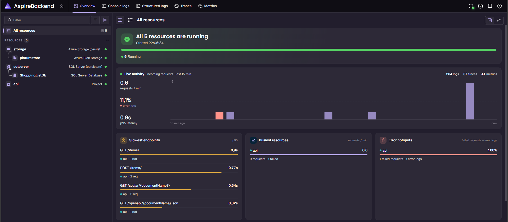
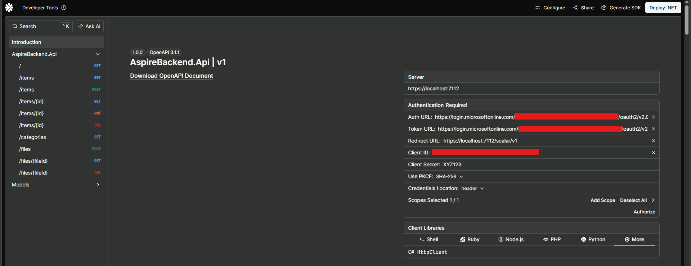

## Aspire Backend template

### Tools

Package updater
```bash
dotnet tool install --global dotnet-outdated-tool
dotnet outdated --version-lock major --upgrade
```

Migration with ef
```bash
dotnet ef migrations add AddEntities --project AspireBackend.Api/AspireBackend.Api.csproj -o Data/Migrations
```

### Configuration

Set up OIDC with an auth provider: [EntraID](https://www.youtube.com/watch?v=SZTsdOpEb8M). Register an api and a client application and fill their config values.  

Append `AspireBackend.Api/appsettings.json` with
```json
"Auth": {
    "Authority": "https://login.microsoftonline.com/<tenant-id>/v2.0",
    "Audience": "<api-app-id>",
    "Issuer": "https://sts.windows.net/<tenant-id>/",
    "ApiScopes": ["api://<api-app-id>/shoppinglist_api.all"]
},
```

Append `apphost.settings.json` with
```json
"Scalar": {
    "ClientId": "<client-app-id>",
    "AuthorizationUrl": "https://login.microsoftonline.com/<tenant-id>/oauth2/v2.0/authorize",
    "TokenUrl": "https://login.microsoftonline.com/<tenant-id>/oauth2/v2.0/token"
}
```

### Images

#### Aspire 17
 

#### Scalar AuthorizationCodeFlow
 